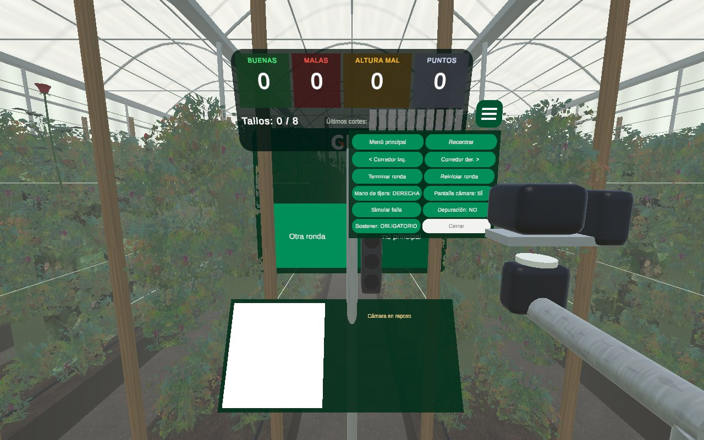

# Rosas XR · GHT

Entrenamiento en realidad virtual para el corte de rosas con Meta Quest 3. Lo desarrolló el equipo Team Rocket para GHT en la SabanaHack 2026.

El principio de diseño es que **el sistema forma el criterio del cortador, no decide por él**.



## Qué hace

**Etapa 1 · Aprende a ver**
- Fotos reales de rosas en tres estados: inmadura, en punto y pasada.
- Dos ejercicios: "¿se corta?" y "¿en qué estado está?".
- Lecciones de 10 fotos con vidas, puntos, racha, insignias y repetición espaciada.
- La Etapa 2 se desbloquea con 80% de acierto en las últimas 30 respuestas y mínimo 70% en cada estado. El modo jurado salta este requisito.

**Etapa 2 · Cosecha con el carro**
- Invernadero con 3 corredores y 207 rosas en 6 grados de apertura.
- El cortador empuja el carro con la mano.
- La cámara del carro, montada sobre dos servos (pan-tilt), sigue la tijera para ver qué se va a cortar y por dónde.
- El LED de la tijera y el semáforo del carro indican:
  - **Verde:** corta aquí.
  - **Rojo:** no cortes, por el estado de la rosa o por la altura del corte.
  - **Ámbar:** el sistema duda.
- El tallo se sostiene con una mano, se corta con la seña de tijera y se deja en la canasta.
- Hay puntos y bono de criterio (cuando el cortador tiene razón y el sistema no), un tutorial de 6 pasos y un registro CSV por operario.

**Práctica con rosas reales**
- Usa el passthrough del visor y el modelo ONNX del equipo, que corre en las gafas.

**Voz guía**
- Narra el tutorial y avisa antes de un mal corte, por punto de apertura o por largo del tallo.
- Felicita los cortes correctos.
- La voz es Salomé (Azure, español de Colombia). Los audios van dentro de la app, así que funciona sin internet.

## Estructura del repositorio

```
apk/             RosasXR-GHT.apk: instalable en Meta Quest 3
codigo_fuente/   Proyecto Unity (Assets, Packages, ProjectSettings)
  Assets/RosasXR/
    Scripts/Core      Perfil, pedido, registro, sonido, voz guía, menú flotante
    Scripts/Stage1    Etapa 1 (fotos)
    Scripts/Stage2    Etapa 2: carro, cámara pan-tilt, tijera, manos, rosas, clasificador, controlador
    Scripts/Menu      Menú principal
    Scripts/Editor    Generadores de escenas, voces, prueba automática y capturas
    Modelos3D/        Modelos 3D de la rosa (triángulo, cuadrado y copa)
    Modelos/          Modelo ONNX del equipo
    Resources/Voz/    Audios de la voz guía
  Assets/StreamingAssets/fotos/   Fotos reales y manifiesto (manifiesto.csv)
  Herramientas/exportar_onnx.py   Exportación del modelo a ONNX
capturas/        Vistas del invernadero generadas desde el editor
```

## Instalar el APK en unas gafas

1. Activa el modo desarrollador en las gafas. Desde la app Meta Horizon en el celular, la cuenta tiene que pertenecer a una organización de desarrollador verificada.
2. Conecta las gafas por USB y acepta "Permitir depuración USB".
3. Instala `apk/RosasXR-GHT.apk` con Meta Quest Developer Hub (arrastrar el archivo) o con SideQuest.
4. En las gafas, abre la app desde Biblioteca → Fuentes desconocidas.

## Abrir y compilar el proyecto

1. Instala **Unity 6000.0.85f1** con *Android Build Support* (OpenJDK, Android SDK y NDK).
2. Abre la carpeta `codigo_fuente/` con Unity Hub. La primera vez descarga los paquetes del Meta XR SDK y regenera `Library/`.
3. Usa el menú **Rosas XR**:
   - **3. Construir escenas y prefabs.** Genera por código las escenas Menú, Etapa1, Cosecha y PracticaYOLO.
   - **8. Prueba automática (Cosecha).** Pone la tijera en 10 situaciones y verifica el LED, el semáforo y la voz. El resultado sale en la consola.
   - **9. Captura de prueba (Cosecha).** Genera imágenes del invernadero sin ponerse las gafas.
   - **10. Generar voces (narración).** Genera la voz con el Mac, usando el comando `say`.
   - **11. Voz neural (Azure: Salomé).** Regenera los audios con Azure. La clave se guarda solo en las preferencias de Unity del equipo local; nunca va en el proyecto ni en el APK.
4. **File → Build And Run**, con las gafas conectadas.

## Notas

- **Clasificador de la Etapa 2.** Hoy es simulado: se equivoca a propósito el 10% de las veces para entrenar el criterio. Está detrás de la interfaz `IGradeClassifier`, así que se puede conectar el modelo real.
- **Regla de largo de tallo.** El pedido (grado 3–4, tallo de 35–50 cm, meta de 8 tallos) es un valor de ejemplo que falta validar con el agrónomo. Está en `Scripts/Core/HarvestOrder.cs`.
- **Proyecto base.** El proyecto parte del sample *Unity-PassthroughCameraApiSamples* de Meta. Su código conserva la licencia original (`codigo_fuente/LICENSE.txt`).
- **Logo y colores de GHT.** Se usan con permiso de GHT. Las fotos de rosas son de uso del proyecto.
